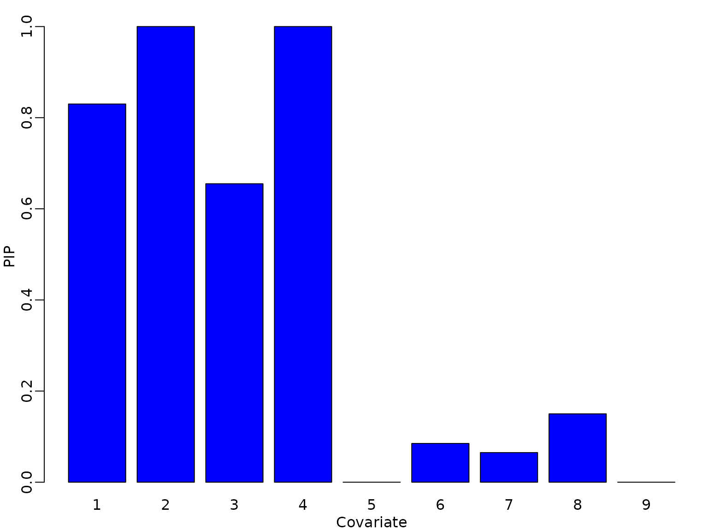

# Chapter 12: Model Assessment and Predictive Model Checking

## Section 12.1: Beyond classical Bayesian model comparison

### Section 12.1.1: Schwarz criterion and BIC

#### Example 12.1: Labor market data: Bayesian variable selection using BIC

We return to the probit analysis of Example 11.11 and run variable
selection using the Schwarz criterion instead of the marginal
likelihood. We first implement this approach.

``` r

modsel_probit_BIC <- function(y, X, burnin = 1000L, M = 5000L) {
  N <- length(y)
  p <- ncol(X)

  gamma_post <- matrix(0L, nrow = M, ncol = p,
                       dimnames = list(NULL, colnames(X)))
  acc <- integer(length = M)

  gamma <- rep(1L, length.out = p)
  mod0 <- glm(y ~ X, family = binomial(link = "probit"))
  SC_old <- logLik(mod0) - log(N) * (p + 1) / 2

  for (m in seq_len(burnin + M)) {
    gamma_proposed <- gamma

    j <- sample(1:p, size = 1)
    gamma_proposed[j] <- 1 - gamma[j]

    X_gamma <- X[, gamma_proposed == 1]
    model <- glm(y ~ X_gamma, family = binomial(link = "probit"))
    SC_proposed <- logLik(model) - log(N) * (sum(gamma_proposed) + 1) / 2
    
    # Compute acceptance probability and decide on acceptance
    log_acc <- SC_proposed - SC_old

    if (log(runif(1)) < log_acc) {
      gamma <- gamma_proposed
      SC_old <- SC_proposed
      accept <- 1L
    } else {
      accept <- 0L
    }

    if (m > burnin) {
      gamma_post[m - burnin, ] <- gamma
      acc[m - burnin] <- accept
    }
  }
  return(list(gamma_post = gamma_post, acc = acc))
}
```

Next we load the data and add 5 irrelevant, standard normal regressors
as in Example 11.11. Then we run the algorithm.

``` r

library("BayesianLearningCode")
data("labor", package = "BayesianLearningCode")
y <- labor$income_1998 == "zero"
N <- length(y)
X_unemp <- with(labor, cbind(female = female,
                             age18 = 1998 - birthyear - 18,
                             wcollar = wcollar_1997,
                             unemp97 = income_1997 == "zero")) # regressor matrix
p_irrel <- 5
set.seed(seed)
X <- cbind(X_unemp, matrix(rnorm(p_irrel * N), ncol = p_irrel))
p <- ncol(X)
colnames(X)[ncol(X_unemp) + (1:p_irrel)] <-
  paste0("irrel", seq_len(p_irrel))

M <- 20000 / mcmcspeedup
res <- modsel_probit_BIC(y, X, M = M)
```

We determine the number of models visited during MCMC, the average model
complexity, i.e., the average number of covariates included in the
model, and show the posterior inclusion probabilities.

``` r

if (pdfplots) {
  pdf("12-1_1.pdf", width = 5, height = 6)
}
par(mfrow = c(1, 1), mar = c(2.5, 2.5, 1.5, .5), mgp = c(1.5, .5, 0))

gammas <- unique(res$gamma_post)
nrow(gammas)
#> [1] 21

k_gamma <- rowSums(res$gamma_post)
mean(k_gamma)
#> [1] 3.7335

# PIPs
colMeans(res$gamma_post)
#>  female   age18 wcollar unemp97  irrel1  irrel2  irrel3  irrel4  irrel5 
#>  0.8995  1.0000  0.7020  1.0000  0.0320  0.0085  0.0065  0.0710  0.0140
barplot(colMeans(res$gamma_post), col = "blue", names.arg = 1:p,
        xlab = "Covariate", ylab = "PIP")
```



To determine the models visited most often we re-use a function which we
defined in Chapter 11.

``` r

number_draws <- function(gamma_post, models) {
  sapply(1:nrow(models), function(j)
    sum(apply(gamma_post, 1, function(x) identical(x, models[j,]))))
}
n_gamma <- number_draws(res$gamma_post, gammas)
io <- order(n_gamma, decreasing = TRUE)
knitr::kable(cbind(gammas, phat_gamma = n_gamma / M)[io[1:5], ],
             digits = c(rep(0, p), 4))
```

| female | age18 | wcollar | unemp97 | irrel1 | irrel2 | irrel3 | irrel4 | irrel5 | phat_gamma |
|-------:|------:|--------:|--------:|-------:|-------:|-------:|-------:|-------:|-----------:|
|      1 |     1 |       1 |       1 |      0 |      0 |      0 |      0 |      0 |     0.5915 |
|      1 |     1 |       0 |       1 |      0 |      0 |      0 |      0 |      0 |     0.2060 |
|      0 |     1 |       0 |       1 |      0 |      0 |      0 |      0 |      0 |     0.0580 |
|      1 |     1 |       1 |       1 |      0 |      0 |      0 |      1 |      0 |     0.0380 |
|      0 |     1 |       1 |       1 |      0 |      0 |      0 |      0 |      0 |     0.0255 |

### Section 12.1.2: Perspectives on Bayesian model comparison

\[no code\]

## Section 12.2: Comparative model assessment through predictive information criteria

### Section 12.2.1: Measuring predictive loss

\[no code\]

### Section 12.2.2: Akaike information criterion (AIC)

#### Example 12.2: U.S. GDP data: Choosing the model order via AIC and BIC

We need to re-load the function which creates the design matrix.

``` r

ARdesignmatrix <- function(dat, p = 1, conditioninglength = p) {
  d <- p + 1
  N <- length(dat) - p

  Xy <- matrix(NA_real_, N, d)
  Xy[, 1] <- 1
  for (i in seq_len(p)) {
    Xy[, i + 1] <- dat[(p + 1 - i) : (length(dat) - i)]
  }
  Xy[(1 + conditioninglength - p):N, , drop = FALSE]
}
```

Let’s load the data and compute log returns.

``` r

data("gdp", package = "BayesianLearningCode")
logret <- diff(log(gdp))
```

Now we compute five OLS estimates and the corresponding AICs and BICs.

``` r

AIC <- BIC <- rep(NA_real_, 5)
names(AIC) <- 0:4
for (i in seq_along(AIC)) {
  y <- tail(logret, -4)
  p <- i - 1     # lag length
  d <- i + 1     # total number of parameters
  N <- length(y) # number of data points used for estimation
  Xy <- ARdesignmatrix(logret, p, conditioninglength = 4)
  fit <- lm(y ~ Xy - 1)
  betahat <- coef(fit)
  sigma2hat <- sum(resid(fit)^2) / length(y)
  minus2timesloglikmax <- N * (1 + log(2 * pi)) + N * log(sigma2hat)
  AIC[i] <- minus2timesloglikmax + 2 * d      # equals built-in AIC(fit)
  BIC[i] <- minus2timesloglikmax + log(N) * d # equals built-in BIC(fit)
}
knitr::kable(rbind(AIC, BIC), digits = 2)
```

|     |        0 |        1 |        2 |        3 |        4 |
|:----|---------:|---------:|---------:|---------:|---------:|
| AIC | -1808.61 | -1828.87 | -1839.65 | -1837.66 | -1836.24 |
| BIC | -1801.15 | -1817.68 | -1824.72 | -1819.01 | -1813.86 |

### Section 12.2.3: Deviance information criterion (DIC)

#### Example 12.6: CHF exchange rate data: Testing normal vs. t using DIC

Let’s load the data first and make some space for the draws under the
three models.

``` r

data("exrates", package = "stochvol")
y <- 100 * diff(log(exrates$USD / exrates$CHF))
X <- 1
N <- length(y)

draws <- vector("list", 3)
```

Under the zero-mean Gaussian model, the posterior of $`\sigma^2`$ is
inverse gamma, and we can easily draw from it.

``` r

set.seed(seed)
c0 <- 2.5
C0 <- 1.5

SSR <- sum(y^2)
cN <- c0 + N / 2
CN <- C0 + SSR / 2

# number of draws
M <- 100000 / mcmcspeedup

# thinning to save some computer memory (1 = no thinning)
thin <- 1

draws[[1]]$sigma2s <- rinvgamma(M / thin, cN , CN)
draws[[1]]$nus <- Inf
```

Under the t distribution with 7 degrees of freedom, the posterior of
$`\sigma^2`$ is not available in closed form, but we can draw from it
using data augmentation.

``` r

burnin <- 100

# fix df
nu <- 7

# allocate space for storing the draws
draws[[2]]$sigma2s <- rep(NA_real_, M / thin)
draws[[2]]$nus <- rep(nu, M / thin)
draws[[2]]$ws <- matrix(NA_real_, nrow = M / thin, ncol = N)

# starting value for w
w <- rep(1, N)

# pre-compute cN
cN <- c0 + N / 2

# log likelihood
loglik <- function(y, sigma2, nu) {
  sum(dstudt(y, 0, sqrt(sigma2), df = nu, log = TRUE))
}

for (m in 1:(burnin + M)) {
  # sample sigma^2 from its full conditional (S-DA)
  eps <- sqrt(w) * y
  CN <- C0 + crossprod(eps) / 2
  sigma2 <- rinvgamma(1, cN, CN)

  # sample w (W-DA)
  r <- eps^2 / (w * sigma2)
  w <- rgamma(length(eps), (nu + 1) /2, (nu + r) / 2)

  # store the results
  if (m > burnin && (m - burnin) %% thin == 0L) {
    draws[[2]]$sigma2s[(m - burnin) / thin] <- sigma2
    draws[[2]]$ws[(m - burnin) / thin, ] <- w
  }
}
```

For sampling also the degrees of freedom under an exponential prior, we
re-run the sampler from Example 8.16, but this time without an
intercept.

``` r

# fix tuning parameter for MH
cnu <- 0.3

# fix prior hyperparameters
lambda <- 1 / 7

# allocate space for storing the draws
draws[[3]]$nus <- draws[[3]]$sigma2s <- rep(NA_real_, M / thin)
draws[[3]]$ws <- matrix(NA_real_, nrow = M / thin, ncol = N)

# starting value for log(nu) and w
w <- rep(1, N)
nu <- 7

accepts <- 0L
for (m in 1:(burnin + M)) {
  # sample sigma^2 from its full conditional (S-DA)
  eps <- sqrt(w) * y
  CN <- C0 + crossprod(eps) / 2
  sigma2 <- rinvgamma(1, cN, CN)

  # sample nu (N-MH)
  nuprop <- exp(rnorm(1, log(nu), cnu))
  logR <- loglik(y, sigma2, nuprop) -
          loglik(y, sigma2, nu) +
          dexp(nuprop, lambda, log = TRUE) -
          dexp(nu, lambda, log = TRUE) +
          log(nuprop) -
          log(nu)
  
  if (log(runif(1)) < logR) {
    nu <- nuprop
    if (m > burnin) accepts <- accepts + 1L
  }
  
  # sample w (W-DA)
  r <- eps^2 / (w * sigma2)
  w <- rgamma(length(eps), (nu + 1) /2, (nu + r) / 2)

  # store the results
  if (m > burnin && (m - burnin) %% thin == 0L) {
    draws[[3]]$sigma2s[(m - burnin) / thin] <- sigma2
    draws[[3]]$nus[(m - burnin) / thin] <- nu
    draws[[3]]$ws[(m - burnin) / thin, ] <- w
  }
}
```

We can now estimate the DIC from the draws. First, we define the
deviance function $`D`$.

``` r

D_nonvec <- function(y, sigma2, nu) -2 * loglik(y, sigma2, nu)
D <- Vectorize(D_nonvec, c("sigma2", "nu"))
```

Before we move on, let us define a function that sorts a vector into
batches, and another one which computes the batch-wise means. That way,
we can numerically gauge the precision of our estimates.

``` r

batches <- function(x, amount = 10) {
  matrix(x, ncol = amount)
}

batchMeans <- function(x, amount = 10) {
  colMeans(batches(x, amount = amount))
}
```

Now, we estimate the average deviance, the deviance of the posterior
averages, the effective number of parameters, and, finally, DIC.

``` r

res <- array(NA_real_, c(3, 4, 10))
colnames(res) <- c("DIC", "avgD", "Davg", "pd")
for (i in 1:nrow(res)) {
  d <- draws[[i]]
  res[i, "avgD", ] <- batchMeans(D(y, d$sigma2s, d$nus))
  res[i, "Davg", ] <- D(y, batchMeans(d$sigma2s), batchMeans(d$nus))
  res[i, "pd", ] <-  res[i, "avgD", ] - res[i, "Davg", ]
  res[i, "DIC", ] <- res[i, "avgD", ] + res[i, "pd", ]
}
knitr::kable(apply(res, 1:2, min), digits = 2)
```

|     DIC |    avgD |    Davg |   pd |
|--------:|--------:|--------:|-----:|
| 6906.83 | 6905.88 | 6904.93 | 0.95 |
| 6605.35 | 6604.45 | 6603.54 | 0.90 |
| 6605.29 | 6603.45 | 6601.61 | 1.79 |

``` r

knitr::kable(apply(res, 1:2, mean), digits = 2)
```

|     DIC |    avgD |    Davg |   pd |
|--------:|--------:|--------:|-----:|
| 6906.99 | 6905.96 | 6904.93 | 1.03 |
| 6605.48 | 6604.51 | 6603.55 | 0.97 |
| 6605.57 | 6603.60 | 6601.63 | 1.97 |

``` r

knitr::kable(apply(res, 1:2, max), digits = 2)
```

|     DIC |    avgD |    Davg |   pd |
|--------:|--------:|--------:|-----:|
| 6907.09 | 6906.01 | 6904.94 | 1.08 |
| 6605.68 | 6604.62 | 6603.56 | 1.06 |
| 6606.21 | 6603.91 | 6601.76 | 2.30 |

For the Gaussian model (only), we can compute the DIC in closed form.

``` r

cN <- c0 + N / 2
CN <- C0 + SSR / 2
Davg <- N * log(2 * pi * CN / (cN - 1)) + (cN - 1) * SSR / CN
avgD <- N * (log(2 * pi * CN) - digamma(cN)) + SSR * cN / CN
pd <- avgD - Davg
# Explicitly: N * (log(cN - 1) - digamma(cN)) + SSR / CN
DIC <- avgD + pd
# N * log(2 * pi * CN * (cN - 1)) - 2 * N * digamma(cN) + (cN + 1) * SSR / CN
knitr::kable(cbind(DIC, avgD, Davg, pd))
```

|      DIC |     avgD |     Davg |       pd |
|---------:|---------:|---------:|---------:|
| 6906.922 | 6905.925 | 6904.927 | 0.997449 |

#### Example 12.7: CHF exchange rate data: Testing normal vs. Student t using hierarchical DIC

Because we also stored the weights, we can use the samples from above to
compute conditional and augmented DICs. To do so, we first define the
log conditional likelihood. and the log augmented (“complete-data”)
likelihood.

``` r

logcondlik <- function(y, sigma2, nu, w) {
  sum(dnorm(y, 0, sqrt(sigma2 / w), log = TRUE))
}

logauglik <- function(y, sigma2, nu, w) {
  logcondlik(y, sigma2, nu, w) + sum(dgamma(w, nu / 2, nu / 2, log = TRUE))
}
```

Now we can compute the conditional and the augmented DIC.

``` r

res <- array(NA_real_, c(2, 4, 10))
colnames(res) <- c("DIC_C", "pd_C", "DIC_A", "pd_A")
for (i in 1:nrow(res)) {
  d <- draws[[i + 1]]
  
  # Evaluate the log conditional likelihood at all posterior draws
  alllogcondlik <- sapply(seq_along(d$sigma2s), function(j) {
    logcondlik(y, d$sigma2s[j], d$nus[j], d$ws[j, ])
  })
  
  # Compute the average conditional deviance
  avgcondD <- -2 * batchMeans(alllogcondlik)
  
  # Evaluate the log augmented likelihood at all posterior draws
  alllogauglik <- sapply(seq_along(d$sigma2s), function(j) {
    logauglik(y, d$sigma2s[j], d$nus[j], d$ws[j, ])
  })
  
  # Evaluate the unnormalized log posterior
  alllogpost_unnormalized <- alllogauglik +
    dinvgamma(d$sigma2s, c0, C0, log = TRUE) + dexp(d$nus, lambda, log = TRUE)
  
  # Find the index of the posterior draw with highest joint posterior density
  MAPind <- apply(batches(alllogpost_unnormalized), 2, which.max)
  
  # Evaluate the conditional deviance at the MAP
  estcondD <- -2 * batches(alllogcondlik)[cbind(MAPind, seq_len(dim(res)[3]))]
  
  # Compute conditional pd and conditional DIC
  res[i, "pd_C", ] <- avgcondD - estcondD
  res[i, "DIC_C", ] <- 2 * avgcondD - estcondD
  
  # Compute the average augmented deviance
  avgaugD <- -2 * batchMeans(alllogauglik)
  
  # Evaluate the augmented deviance at the MAP
  estaugD <- -2 * batches(alllogauglik)[cbind(MAPind, seq_len(dim(res)[3]))]
  
  # Compute augmented pd and augmented DIC
  res[i, "pd_A", ] <- avgaugD - estaugD
  res[i, "DIC_A", ] <- 2 * avgaugD - estaugD
}
knitr::kable(apply(res, 1:2, min), digits = 2)
```

|   DIC_C |    pd_C |    DIC_A |   pd_A |
|--------:|--------:|---------:|-------:|
| 6125.46 |    3.55 | 10705.80 | 229.25 |
| 5901.34 | -179.81 | 11276.91 | 590.60 |

``` r

knitr::kable(apply(res, 1:2, mean), digits = 2)
```

|   DIC_C |   pd_C |    DIC_A |   pd_A |
|--------:|-------:|---------:|-------:|
| 6160.26 |  37.87 | 10742.55 | 266.44 |
| 6002.80 | -79.09 | 11412.62 | 689.00 |

``` r

knitr::kable(apply(res, 1:2, max), digits = 2)
```

|   DIC_C |   pd_C |    DIC_A |   pd_A |
|--------:|-------:|---------:|-------:|
| 6231.83 | 108.02 | 10784.09 | 308.95 |
| 6091.61 |  12.03 | 11594.55 | 861.75 |

Let’s try with the posterior mean as point estimate.

``` r

res <- array(NA_real_, c(2, 4, 10))
colnames(res) <- c("DIC_C", "pd_C", "DIC_A", "pd_A")
for (i in 1:nrow(res)) {
  d <- draws[[i + 1]]
  
  # Evaluate the log conditional likelihood at all posterior draws
  alllogcondlik <- sapply(seq_along(d$sigma2s), function(j) {
    logcondlik(y, d$sigma2s[j], d$nus[j], d$ws[j, ])
  })
  
  # Compute the average conditional deviance
  avgcondD <- -2 * batchMeans(alllogcondlik)
  
  # Evaluate the log augmented likelihood at all posterior draws
  alllogauglik <- sapply(seq_along(d$sigma2s), function(j) {
    logauglik(y, d$sigma2s[j], d$nus[j], d$ws[j, ])
  })
  
  # Evaluate the conditional deviance at the posterior mean
  sigma2means <- batchMeans(d$sigma2s)
  numeans <- batchMeans(d$nus)
  wmeans <- apply(d$ws, 2, batchMeans)
  
  estcondD <- rep(NA_real_, dim(res)[3])
  for (j in seq_len(dim(res)[3])) {
    estcondD[j] <- -2 * logcondlik(y, sigma2means[j], numeans[j], wmeans[j, ])
  }
  
  # Compute conditional pd and conditional DIC
  res[i, "pd_C", ] <- avgcondD - estcondD
  res[i, "DIC_C", ] <- 2 * avgcondD - estcondD
  
  # Compute the average augmented deviance
  avgaugD <- -2 * batchMeans(alllogauglik)
  
  # Evaluate the augmented deviance at the posterior mean
  estaugD <- rep(NA_real_, dim(res)[3])
  for (j in seq_len(dim(res)[3])) {
    estaugD[j] <- -2 * logauglik(y, sigma2means[j], numeans[j], wmeans[j, ])
  }
  
  # Compute augmented pd and augmented DIC
  res[i, "pd_A", ] <- avgaugD - estaugD
  res[i, "DIC_A", ] <- 2 * avgaugD - estaugD
}
knitr::kable(apply(res, 1:2, min), digits = 2)
```

|   DIC_C |   pd_C |    DIC_A |    pd_A |
|--------:|-------:|---------:|--------:|
| 6529.24 | 408.05 | 12917.69 | 2445.54 |
| 6539.79 | 451.65 | 13076.67 | 2366.44 |

``` r

knitr::kable(apply(res, 1:2, mean), digits = 2)
```

|   DIC_C |   pd_C |    DIC_A |    pd_A |
|--------:|-------:|---------:|--------:|
| 6531.28 | 408.89 | 12926.71 | 2450.60 |
| 6542.37 | 460.48 | 13097.58 | 2373.95 |

``` r

knitr::kable(apply(res, 1:2, max), digits = 2)
```

|   DIC_C |  pd_C |    DIC_A |    pd_A |
|--------:|------:|---------:|--------:|
| 6533.37 | 409.5 | 12930.58 | 2454.44 |
| 6545.51 | 463.2 | 13106.25 | 2390.37 |

### Section 12.2.4: Widely applicable information criterion (WAIC)

#### Example 3.8: CHF exchange rate data: Testing normal vs. t using WAIC

``` r

resWAIC <- array(NA_real_, c(3, 6, 10))
colnames(resWAIC) <-
  c("WAIC", "Dbiased", "phat", "WAIC_C", "Dbiased_C", "phat_C")
logpredlik <- Ehat <- Vhat <- logcondpredlik <- condEhat <- condVhat <-
  matrix(NA_real_, length(y), dim(resWAIC)[3])
for (i in 1:nrow(resWAIC)) {
  d <- draws[[i]]
  for (j in seq_along(y)) {
    logpredlikdraws <- dstudt(y[j], 0, sqrt(d$sigma2s), d$nus, log = TRUE)
    logpredlik[j, ] <- apply(batches(logpredlikdraws), 2, logmeanexp)
    Ehat[j, ] <- batchMeans(logpredlikdraws)
    Vhat[j, ] <- batchMeans(logpredlikdraws^2) - Ehat[j ,]^2
    if (i >= 2L) { # also evaluate the log conditional predictive likelihood
      logcondpredlikdraws <- dnorm(y[j], 0, sqrt(d$sigma2s / d$ws[, j]),
                                   log = TRUE)
      logcondpredlik[j, ] <- apply(batches(logcondpredlikdraws), 2, logmeanexp)
      condEhat[j, ] <- batchMeans(logcondpredlikdraws)
      condVhat[j, ] <- batchMeans(logcondpredlikdraws^2) - condEhat[j ,]^2
    }
  }
  resWAIC[i, "Dbiased", ] <- -2 * batchMeans(logpredlik)
  resWAIC[i, "phat", ] <- colSums(Vhat)
  resWAIC[i, "WAIC", ] <- resWAIC[i, "Dbiased", ] + 2 * resWAIC[i, "phat", ]
  if (i >= 2L) { # also evaluate the log conditional predictive likelihood
    resWAIC[i, "Dbiased_C", ] <- -2 * batchMeans(logcondpredlik)
    resWAIC[i, "phat_C", ] <- colSums(condVhat)
    resWAIC[i, "WAIC_C", ] <-
      resWAIC[i, "Dbiased_C", ] + 2 * resWAIC[i, "phat_C", ]
  }
}
mins <- apply(resWAIC, 1:2, min)
maxs <- apply(resWAIC, 1:2, max)
s <- c(1, 3:4, 6)
out <- matrix(paste0("[", round(mins[, s], 2), ", ", round(maxs[, s], 2), "]"),
              nrow = dim(resWAIC)[1])
out[out == "[NA, NA]"] <- ""
colnames(out) <- colnames(resWAIC)[s]
rownames(out) <- c("Gaussian", "t_7", "t_nu")
knitr::kable(out)
```

|  | WAIC | phat | WAIC_C | phat_C |
|:---|:---|:---|:---|:---|
| Gaussian | \[11.83, 13.18\] | \[4.81, 5.49\] |  |  |
| t_7 | \[3.93, 4.25\] | \[0.92, 1.07\] | \[606.36, 610.94\] | \[302.25, 304.54\] |
| t_nu | \[6.47, 7.82\] | \[2.19, 2.86\] | \[645.76, 654.56\] | \[321.95, 326.35\] |

## Section 12.3: Comparative model assessment through scoring rules

### Section 3.3.1: Log predictive density scores
